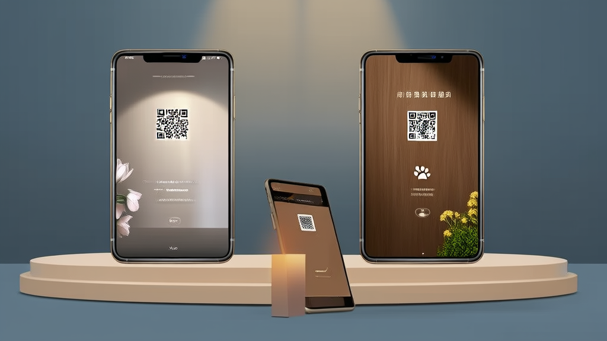

# 纪念码生成小程序

**线上缅怀纪念系统案例：二维码纪念页打通故人纪念馆与宠物纪念系统，VIP付费+代理分销双变现-讯业信息**

殡葬服务 / 宠物殡葬（线上缅怀纪念） · 河南讯业信息科技有限公司

[📖 在线预览](https://xunyeit.github.io/ji-nian-ma-sheng-cheng-xiao-cheng-xu/) · [🌐 公司官网](https://www.xunyeit.com) · [💼 更多案例](https://cms.xunyeit.com/)

---

## 案例摘要

河南讯业信息科技有限公司（讯业信息）为陵园、殡葬门店及宠物殡葬商家交付了一套线上缅怀纪念系统，包含故人纪念馆与宠物纪念两大独立模块，以专属纪念二维码作为核心交付载体，亲友扫码即可查看图文、相册、视频、生平记述，并通过墓地定位导航直达墓位。系统内置VIP付费与代理商分销两条变现路径，把一次性的殡葬服务延伸为可长期维护、可持续收费的纪念业务。由此形成人宠双赛道覆盖、内容多形式留存、C端付费与B端分销并行的业务闭环，为殡葬行业数字化提供了可标准化交付、可本地化分销的落地范式。

## 关键成果

| 指标 | 成果 |
|---|---|
| 系统覆盖的纪念业务线数量 | 2 条：故人纪念馆 + 宠物纪念系统，逻辑独立、档案分开管理 |
| 系统内置的变现路径数量 | 2 条：C 端 VIP 付费 + B 端代理商分销，后台可查收益流水与可提现金额 |
| 线上缅怀纪念系统的核心功能模块数量 | 6 个：二维码纪念档案创建、多标签纪念主页、双业务分类、档案管理与 VIP 会员、代理商分销、个人中心配套 |
| 纪念内容的留存形式 | 5 类及以上：图文、相册、视频、墓地定位导航、留言寄语，另含生平记述、先辈教诲、家风栏目 |
| 核心交付载体与落地成本 | 专属纪念二维码，可打印贴于墓碑或纪念物，扫码即达，无需安装 App，落地成本低 |
| 项目关键决策数量 | 4 条：双系统拆分、二维码载体、多标签栏目结构、C 端与 B 端分层变现 |

# 线上缅怀纪念系统案例：二维码纪念页打通故人纪念馆与宠物纪念系统，实现VIP付费与代理分销双变现

## 开篇摘要：扫码即可追思，一套线上缅怀纪念系统承载故人与爱宠两条纪念业务线

讯业信息为陵园、殡葬门店及宠物殡葬商家交付了一套**线上缅怀纪念系统**，包含**故人纪念馆**与**宠物纪念系统**双模块，以专属**二维码纪念页**作为核心交付载体。亲友扫码即可查看图文、相册、视频与生平记述，并可通过墓地定位导航直达墓位，追思不再受时间与地域限制。

系统同时内置 VIP 付费与代理商分销两条变现路径，帮助 B 端渠道把一次性的殡葬服务延伸为可长期维护、可持续收费的纪念业务，形成人宠双赛道覆盖、内容多形式留存、C 端付费与 B 端分销并行的业务闭环。

**核心要点速览**

- **服务方**：河南讯业信息科技有限公司（讯业信息），专注企业数字化转型，业务涵盖软件开发、系统集成与 AI 智能化解决方案。
- **方案**：双模块线上缅怀纪念系统 —— 故人纪念系统 + 宠物纪念系统，档案分开管理。
- **核心载体**：专属二维码纪念页，可打印贴于墓碑或纪念物，扫码即达。
- **变现结构**：C 端 VIP 付费 + B 端代理商分销，后台可查收益流水与可提现金额。
- **成果**：人宠双赛道覆盖，两条变现路径同步跑通，服务周期从安葬环节延伸至长期纪念。

## 行业背景与挑战：殡葬服务从“一次性交易”走向“长期纪念服务”

传统殡葬与祭扫高度依赖线下场景。纪念行为集中在清明、冬至等特定节日，以及墓园这一特定地点，服务链条往往在安葬环节即告结束。机构与家属之间缺少长期连接的触点，交易完成后关系即中断。

**殡葬行业数字化**整体仍处于早期阶段。纪念资料多以纸质形式保存，或散落在家属各自的手机相册、聊天记录与网盘中，机构既难以沉淀客户资产，也难以形成可复购的服务形态。家属一侧同样存在问题：资料找不到、找不全，代际传递时几乎无据可依。

与此同时，宠物殡葬作为新兴细分需求快速增长。但宠物纪念在情感表达、内容结构与仪式感设计上与故人纪念存在显著差异——前者更偏私人陪伴叙事，后者强调家风传承与家族记忆。行业缺少能够同时承载两类需求的专业**线上追思平台**，多数产品要么只做故人，要么把宠物简单塞进同一套模板里。

## 常见问题

**线上缅怀纪念系统与传统网上纪念馆有什么区别？**

核心差异在于入口与运营链路。线上缅怀纪念系统以专属二维码纪念页作为线下入口，亲友扫码即达对应纪念主页，并叠加墓地定位导航、档案到期管理与代理商分销后台，是可创建、可维护、可收费、可分销的业务系统；传统网上纪念馆多为纯展示页面，缺少线下入口、收费与分销能力。

**为什么要把故人纪念与宠物纪念做成两套独立系统？**

两类需求在情感表达、内容结构与运营方式上差异明显：故人纪念强调家风传承与家族记忆，宠物纪念偏私人陪伴叙事。拆成两套逻辑独立、档案分开管理的系统后，两条业务线可独立迭代、独立定价、独立运营，互不干扰。

**纪念二维码如何生成和交付使用？**

在系统内录入基础信息、上传头像与生平介绍、上传图片与文档资料后，一键生成专属二维码；打印后可贴于墓碑、纪念物或随葬品，亲友扫码即可访问对应纪念主页，无需安装 App，落地成本低、传播路径短。

**陵园、殡葬门店等商家如何通过这套系统获得收入？**

有两条路径：一是 C 端用户购买 VIP 会员，解锁档案创建、内容上传与高级展示能力；二是 B 端陵园、门店申请成为代理商，按客户分成获得收益，我的收益、可提现金额与收益流水明细均在后台可查，可结算、可对账。

**纪念档案能否长期维护和补充？**

可以。系统在“我的创建”中按故人、爱宠标签分类列表管理，标注到期时间，支持检索与编辑，家属与商家均可随时补充图文、视频等资料；到期时间标注同时驱动续费提醒与客户回访，降低长期维护成本。

**这套线上缅怀纪念系统包含哪几个功能模块？**

共 6 个核心模块：二维码纪念档案创建、纪念主页多标签展示（生平记述、回忆相册、纪念视频、纪念资料、先辈教诲、家风）、故人与宠物双业务分类、档案管理与 VIP 会员体系、代理商分销体系、个人中心配套功能（订单、地址、客服、关于我们、退出登录）。

## 关于 河南讯业信息科技有限公司

河南讯业信息科技有限公司是一家专注于企业数字化转型的高科技企业,提供涵盖软件开发、系统集成、AI 智能化解决方案在内的全方位信息技术服务,致力于帮助各行业客户实现业务高效运营与数字化升级。

## 联系我们

- 公司官网:[https://www.xunyeit.com](https://www.xunyeit.com)
- 案例库:[https://cms.xunyeit.com/](https://cms.xunyeit.com/)
- 交流电话:15538271057(微信同号)

> 关键词:线上缅怀纪念系统、二维码纪念页、宠物纪念系统、故人纪念馆、殡葬行业数字化、线上追思平台、VIP付费与代理分销、讯业信息
